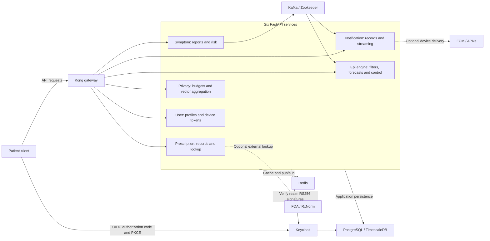

# CyberEpi local portfolio demonstration

## What this project demonstrates

CyberEpi is a research/engineering demonstration of symptom surveillance,
regional epidemiological modeling, and supporting patient workflows. Intended
users are a patient reporting observations and a staff/physician role inspecting
regional forecasts and managing demo records. It is **not medical advice**, a
clinical decision system, or a validated intervention recommendation tool.
Use synthetic data only; do not enter real patient information for a portfolio demo.

The supported target is six application services, one process/container each,
on a Linux host using Podman and podman-compose. Infrastructure containers are
additional to the six services. See [DEPLOYMENT.md](DEPLOYMENT.md#runtime-inventory)
for each service's responsibility and dependencies.



The shared database is a deliberate local simplification: service boundaries
are APIs/modules, not isolated database security domains. Kong routes requests;
services enforce ownership and role authorization themselves. Direct service
ports, database, broker, and authentication ports bind to host loopback.

## Acceptance standard

| Category | Required evidence |
|---|---|
| Core local workflow | Fresh-volume initialization, healthy six-service stack, registration/authentication, local patient identity, three symptom reports with numeric risk, Kafka-derived regional state/Rt, forecast/control, local prescription CRUD, notification records/read state, DP budget and completed FL rounds |
| Failure and persistence | Unauthorized/cross-patient requests rejected; invalid inputs rejected; dependency outages visible and recoverable; completed data survives restart; real PostgreSQL budget concurrency |
| Portfolio readiness | Synthetic-data warnings, provider calls opt-in, meaningful observable outputs, reproducible measurements, safe stop/reset, evidence-based issue dispositions |
| Optional/environment-dependent | Rendered native UI, emulator/device interaction, camera/OCR and actual FCM/APNs delivery; these need separate device/runtime/provider evidence |
| Not an acceptance requirement | Public deployment, multi-replica operation, regulatory compliance, clinical efficacy, a formally established end-to-end privacy guarantee |

## Prepare, start, demonstrate, stop

Prerequisites: Linux, Podman, podman-compose, Python 3.12+, and sufficient disk
and memory. The measured reference host has 16 GB RAM and 10 logical CPUs.
A first build needs access to image/package registries; the runtime demo below
avoids third-party medical/push providers. Installation is not an offline build.
See [capacity measurements](DEPLOYMENT.md#measured-local-capacity-2026-10-18).

Run from the repository root. Choose an unused project name so its volumes are
fresh. Do not attach existing patient/database volumes to a demo.

```bash
bash scripts/setup-venv.sh
make prepare ENV_FILE=.env.portfolio
make up PROJECT=cyberepi-portfolio ENV_FILE=.env.portfolio
make smoke
make status PROJECT=cyberepi-portfolio ENV_FILE=.env.portfolio
```

Preparation creates private credentials and refuses to replace an existing
file. Keep that file for subsequent starts. If the default ports are occupied,
follow the port overrides in [DEPLOYMENT.md](DEPLOYMENT.md#verify-the-running-system)
and export matching harness URLs/`SERVICE_PORT_OFFSET`; changing `PROJECT`
alone does not change ports.

The following mutates **only your selected disposable stack**, provided its
URLs point there. The positive and negative harnesses create synthetic accounts
and records, grant a staff role using local Keycloak admin credentials, update
regional configuration, and consume privacy budgets/FL rounds. They are not
read-only production monitoring tools.

```bash
# Source only your own trusted generated file; do not paste its secrets in logs.
set -a
. ./.env.portfolio
set +a

# Do not opt into device delivery accidentally through an inherited environment.
unset VERIFY_PUSH_TOKEN
.venv/bin/python scripts/verify_all.py
.venv/bin/python scripts/verify_negative.py
```

Medication-provider lookup is skipped unless `--include-external-lookups` is
explicitly supplied. `VERIFY_PUSH_TOKEN` independently opts into device-provider
sending; leave it unset for this demonstration. Do not enable either integration
unless external calls are separately authorized. Local prescription CRUD does
not require medication lookup or provider credentials.

### What to point out during the run

1. **Identity:** registration creates a Keycloak account and a distinct local
   patient UUID. `/patients/me` resolves the token subject to that local patient.
   Public registration cannot assign staff roles; the harness uses the local
   administrator explicitly for its demo physician.
2. **Observation to model:** three synthetic reports produce a finite risk score;
   the first reports can legitimately have null risk. Kafka consumption produces
   regional filter state and Rt. The console shows real HTTP response excerpts,
   forecast trajectories, and control output; these are model outputs, not advice.
   The event adapter currently derives case/admission **proxies** from the risk
   score (`50 * score` and `10 * score`), not observed surveillance counts.
   Rt display bounds are a heuristic ±20%, not calibrated confidence intervals.
3. **Supporting records:** prescriptions can be created/read/completed locally.
   Completed prescriptions are not in the default active-only list. Notification
   creation stores a record; marking it read/unread is not evidence of push delivery.
4. **Privacy experiment:** different authenticated clients submit vectors, a staff
   principal completes a round, and its aggregated update can be read back. Do not
   describe this as training or validating a clinical model.
5. **Boundaries:** the negative harness checks unauthenticated, insufficient-role,
   cross-patient, and malformed requests. Tests using mocks are not provider proof.

For an interactive API surface, open `http://127.0.0.1:8001/docs` through
`http://127.0.0.1:8006/docs`. Protected operations still need a valid token.
The public regional configuration created by the harness can be inspected with:

```bash
curl --fail http://127.0.0.1:8005/api/v1/regions/region-verify/params
.venv/bin/python scripts/measure_stack.py --project cyberepi-portfolio
make down PROJECT=cyberepi-portfolio ENV_FILE=.env.portfolio
```

`down` preserves volumes. To start another clean demo, use another unused project
name **after stopping the first**; retain the same credential file if returning
to the first project. This consumes disk but deletes no prior data. Never run a
global prune or add `down -v` as routine cleanup. No backup-restoration guarantee
is implied; that requires its own restoration exercise.

## Decisions and questions worth being able to answer

- **Why Kafka?** It provides the actual symptom-event path to regional processing
  and notification handling, rather than being an unused architecture ornament.
  Single-broker replication factor one is a local availability tradeoff.
- **What does health mean?** Bounded database/Redis probes and Kafka metadata
  requests where applicable. It does not certify every background consumer,
  scientific correctness, or provider delivery. See shared `health.py`.
- **What happens after a database outage?** Application connections use
  pre-ping/invalidation. Keycloak additionally validates idle JDBC connections
  every 30 seconds. In the audit, health returned 503 during the outage; after
  PostgreSQL restarted, the first patient login returned 500 and a subsequent
  login and `/patients/me` succeeded. This is observed recovery, not guaranteed
  immediate recovery or a hard 30-second availability bound.
- **What survives restart?** PostgreSQL application records, budget accounting,
  persisted filter state and completed FL updates. An incomplete FL upload does
  not survive; its budget charge does. A retry is charged again. One worker and
  one container are required. See [the exact FL constraint](services/privacy-service/SCOPE.md#interrupted-uploads-deliberate-local-demonstration-constraint).
- **Is this formally private?** No platform-wide guarantee is established.
  Atomic epsilon accounting and noise mechanisms are implemented, but caller-
  supplied aggregates, assumed sensitivities and separate FL mechanism/budget
  settings do not establish a composed end-to-end privacy theorem. No regulatory
  compliance is claimed. See [privacy scope](services/privacy-service/SCOPE.md).
- **Do the backtest numbers validate the live API?** No. The standalone SEIHDR/EAKF
  backtest and the live regional EKF/particle-filter/SEIR API are different paths.
  Archived retrospective scoring is not prospective or clinical validation. See
  [BACKTEST_RESULTS.md](BACKTEST_RESULTS.md) and [methods](backtest/METHODS.md).
- **Why not multiple workers?** Active FL state and consumer/process ownership
  need coordination first. More replicas would change behavior, not merely speed.
- **Is the mobile UI verified here?** No. TypeScript/Jest and HTTP/native-boundary
  smoke are distinct from a rendered device. This Linux environment has adb but
  no connected device, emulator binary/AVD, or prebuilt native application; iOS
  Simulator needs macOS. `npx expo start` alone is not proof of a compatible
  native build, camera behavior, deep linking or push delivery.
  A subsequent live-run check also compiled full Android and iOS JavaScript
  bundles after correcting the Metro/image-size dependency mismatch. This is
  stronger than a started packager, but still not device execution. The browser
  launch was attempted and rejected because SDK-compatible `react-native-web`
  and `react-dom` are absent; their required tarballs were not cached locally.
- **What would public deployment require?** A new review of TLS, token issuer/
  audience policy, secrets, database privileges, origin policy, backups, failure
  handling and personal-data governance. Local RS256 realm-key validation is not
  an Internet-facing security certification. Do not expose this stack publicly.

## Evidence and resume wording

Use the independent audit record in [DEPLOYMENT.md](DEPLOYMENT.md), the actual
checks in [README.md](README.md#running-tests), and the per-issue dispositions in
[issues.md](issues.md). Historical reports remain history, not automatic proof
for a new revision. Resource measurements are idle observations on one host,
not scalability benchmarks or minimum-machine guarantees.

Candidate bullets supported by this local demonstration:

- Built a six-service FastAPI cyber-epidemiology demonstration with Keycloak
  role/ownership checks, PostgreSQL/Redis persistence and Kafka-driven regional
  processing, runnable on a local Linux Podman stack.
- Verified PostgreSQL-backed privacy-budget accounting with 50 simultaneous
  first-use requests and exercised federated-round completion/restart recovery;
  documented the single-process and interrupted-upload tradeoffs.
- Exercised synthetic patient reporting through regional state/Rt, forecast and
  control APIs, with local prescription/notification records and negative
  authorization checks; kept provider and native-device claims separate.

Do not add “production-ready,” “clinically validated,” “fully scalable,” or
“guarantees patient privacy.” Do not present historical benchmark results as
accuracy measurements of the live API or as a fresh benchmark run.

## Independent audit evidence (2026-10-18)

The acceptance categories above were checked against the current source, tracked
diff, untracked deliverables, issue history, tests and a disposable local stack.
All eleven original `ISS-01`–`ISS-11` entries are reconciled in `issues.md`.
Earlier completion summaries are not treated as current proof.

| Acceptance criterion | Result and evidence |
|---|---|
| Six-service local startup and empty-database initialization | Met using cached images/source layers and fresh isolated volumes; all six health/metrics probes passed. PostgreSQL contains the Epi head `01fdb56d5f42`, privacy head `2a3f4b5c6d7e`, and Timescale hypertables. |
| Registration, role/ownership boundaries and patient identity | Met: real Keycloak registration/login, local `/patients/me`, duplicate/cross-patient/role rejection; separate actual-app/Expo AuthRequest HTTP smoke covered PKCE, concurrent refresh, logout and refresh-token revocation. Native platform boundaries were shimmed. |
| Synthetic symptoms through regional processing | Met: three reports produced score `0.9742543290868869`, tier `urgent`; live Kafka consumption created filter/Rt records; forecasts/control returned real model outputs. Risk-derived observation proxies and heuristic intervals are not validation of epidemiological accuracy. |
| Prescriptions and notifications | Met for local CRUD, active-list semantics, notification records and JSON read/unread updates. FDA/RxNorm and push sending were explicitly skipped. |
| Privacy/FL and persistence | Met within the documented scope: 50 concurrent first-use budget requests accounted for 5.0 epsilon, exhaustion was rejected, duplicate/closed-round rules held, and completed updates survived restart. Incomplete uploads remain RAM-only; their consumed budget persists. |
| Dependency outage/recovery | Met with a documented interruption: Redis/Kafka/PostgreSQL probes changed to 503 and recovered. After the final PostgreSQL restart, a patient login initially returned 500; a later attempt succeeded at approximately 16.9 seconds and resolved the existing patient. There was a diagnostic gap, so this is not a maximum recovery bound. |
| Portfolio explanation and safe operation | Met by this guide, runtime inventory/capacity commands, explicit synthetic-data/provider warnings, scoped issue dispositions and volume-preserving shutdown. |
| Rendered native UI and actual FCM/APNs delivery | Not verified; optional for this local backend demonstration. No usable emulator/device/native build or provider credentials were available. |
| Public/production deployment, clinical efficacy and platform-wide privacy theorem | Outside scope; none is claimed. |

### Reproducible checks and results

| Check | Observed result |
|---|---|
| Default package pytest runs, separate process per package | 428 passed: shared 53, SEIR core 66, Epi 55, notification 27, prescription 55, privacy 76, symptom 51, user 45 |
| Epi combined default + opt-in run | 65 passed; only 10 are additional to the default count; two use real PostgreSQL/Redis containers, eight mock infrastructure |
| `PYTHONPATH=backtest .venv/bin/python -m pytest backtest/test_scoring_accounting.py -q` | Four passed; finite/missing-truth accounting regressions, not a fresh full-model backtest |
| Patient `npm test -- --runInBand` and local `tsc --noEmit` | 87 tests in six suites passed; TypeScript passed |
| `ruff check libs services scripts apps backtest/run_flusight.py backtest/test_scoring_accounting.py` | Passed |
| Whole-repository `ruff check` | Failed with 57 remaining legacy findings in six scientific scripts and `tests/load/locustfile.py`; not a clean repository-wide lint claim |
| `scripts/smoke.py`, current isolated stack | All six `/health` and `/metrics` probes passed |
| `scripts/verify_all.py`, default offline-provider mode | 54/54 exercised checks passed; two skips: medication-provider lookup and external push |
| `scripts/verify_negative.py` | All exercised invalid-input and authorization checks passed |

The distinct Python total is **442** (428 default + 10 additional opt-in + four
backtest tests), not 497: running the combined Epi suite repeats 55 default tests.
Warnings remain for Starlette TestClient compatibility, SHAP output shape and
deprecated Testcontainers helpers; they were not hidden.

The documented rootless-Podman test command is in [README.md](README.md#running-tests).
The final live run used `cyberepi-independent`, private credentials, loopback
ports 28001–28006, Keycloak 28080 and Kafka 29092:

```bash
# Use YOUR generated private file and matching port overrides, never someone else's.
podman-compose --podman-run-args=--pull=never \
  --env-file "$ENV_FILE" -p "$PROJECT" -f docker-compose.prod.yml \
  up -d --no-build --force-recreate
export SERVICE_PORT_OFFSET=20000 KEYCLOAK_URL=http://127.0.0.1:28080
unset VERIFY_PUSH_TOKEN
.venv/bin/python scripts/smoke.py
.venv/bin/python scripts/verify_all.py
.venv/bin/python scripts/verify_negative.py
.venv/bin/python scripts/measure_stack.py --project "$PROJECT"
```

This audit prohibited third-party contacts. An attempted network-disabled
canonical build could not install uncached dependencies; cached runtime images
with current-source overlay layers were used instead. **A clean registry/package
download build was not independently verified.** The first-build instructions
above require registry/package access; these results prove fresh-volume startup
and runtime workflows, not a completely offline installation.

Current measurements, the host/tool versions and memory sampling limitations
are recorded in [DEPLOYMENT.md](DEPLOYMENT.md#measured-local-capacity-2026-10-18).
The audit then exercised canonical `make down`: all 13 project containers were
removed while all nine associated volumes remained. Only those fresh disposable
audit volumes were subsequently removed; unrelated user resources and cached
images were left intact. Temporary credentials and smoke scaffolding were removed.
